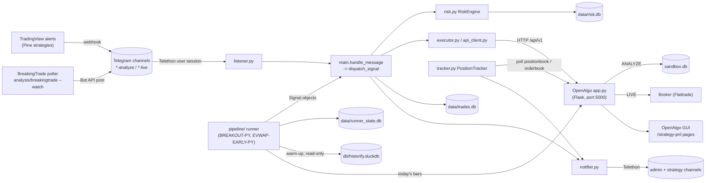
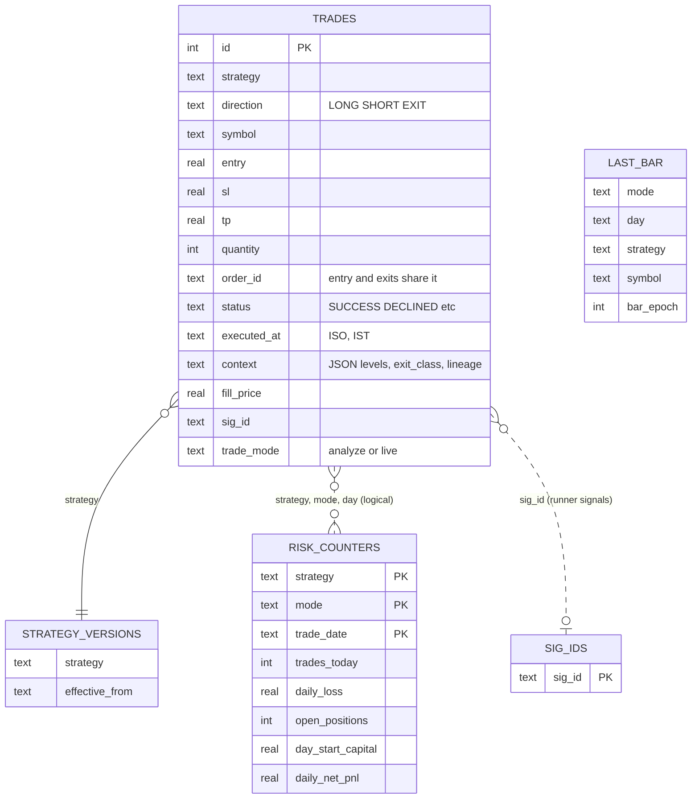
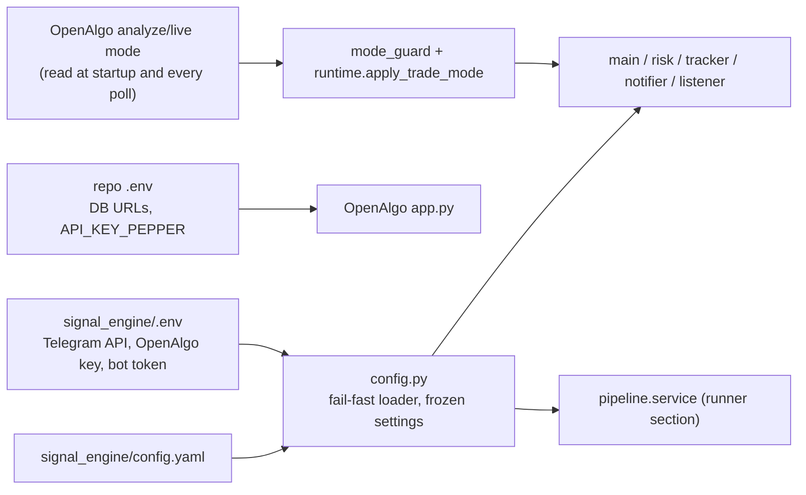

# signal_engine architecture

Status: derived from the code at `a69546290` plus the audit fixes on branch
`review/signal-engine-audit-2026-10-22` (marked "audit fix"). Verified 2026-10-22 against source,
`config.yaml`, the user crontab and the Windows Task Scheduler. Proposed changes are listed only in
[gaps.md](gaps.md), never drawn here as current behavior.

Related: [execution-flow.md](execution-flow.md) (runtime lifecycle),
[data-pipeline.md](data-pipeline.md) (scheduled jobs and backtest data),
[gaps.md](gaps.md) (discrepancies and proposals), `../HOW-IT-WORKS.md` (plain-English ORB guide).

## What it is

One long-running asyncio process (`python -m signal_engine.main`) that turns trade signals into
OpenAlgo orders and manages the resulting positions. Signals come from two sources:

1. **Telegram alerts** (TradingView Pine strategies, and the BreakingTrade poller's bot posts),
   read by a Telethon user session in `listener.py`.
2. **The Python runner** (`pipeline/`), which evaluates `strategy_core` strategies on live bars
   every 5 minutes inside the same process (`BREAKOUT-PY`, `EVWAP-EARLY-PY`, paper only).

Both sources meet in `main.dispatch_signal`, so every signal passes the same gates.

## System context

## Components

| Module | Responsibility | Key entry points |
| --- | --- | --- |
| `main.py` | Signal pipeline: parse, single-source guard, freshness, validate, entry or exit handling, bad-fill guard, unresolved-order sweep | `handle_message`, `dispatch_signal`, `_handle_entry`, `_handle_exit_locked`, `sweep_unresolved_orders` |
| `startup.py` | Health checks, mode detection, reconciliation and tracker restore, task start, degraded mode, shutdown | `start_engine`, `_run_engine`, `reconcile_open_positions`, `_restore_tracker_positions`, `_serve_until_shutdown` |
| `listener.py` | Telethon client, per-message channel-phase gate, flood-wait handling, reconnect | `start_listener`, `_phase_mismatch` |
| `parser.py`, `normalizer.py` | Alert text to `models.Signal` | `parse`, `normalize` |
| `validator.py` | Blacklist, SL side and floor, R:R, duplicate window | `validate` |
| `risk.py`, `risk_store.py` | Sizing, exposure and loss limits, per-strategy counters persisted per (strategy, mode, day) | `RiskEngine.calculate_quantity`, `check_exposure`, `record_trade`, `record_close` |
| `executor.py` | Order building, stop placement and sweeps | `build_order`, `send_order`, `send_bracket_legs` |
| `api_client.py` | OpenAlgo REST client (one shared `httpx.AsyncClient`) | `fetch_positionbook`, `fetch_net_position`, `fetch_orderbook`, `cancel_order`, `close_all_positions` |
| `tracker.py` | Position poll (close detection, missing-stop retry, no-progress exits, mode-flip check), 14:45 time exit, day summary | `PositionTracker.check_positions`, `time_exit_all`, `TimeExitScheduler` |
| `order_reconcile.py` | Orders whose outcome is unknown after a timeout | `UncertainOrder` registry |
| `mode_guard.py` | Process-wide phase and entry halt | `set_startup_phase`, `is_halted` |
| `notifier.py` | Telegram notifications, level filter, phase tag | `notify_event`, `should_notify`, `notify_*` |
| `db.py` | `trades.db` audit trail (one thread-local SQLite connection) | `save`, `save_declined`, `fetch_last_entry_trade` |
| `pipeline/` | Python runner: bar source, warm-up context, cycle, sinks, exit and trail drivers, state store | `service.start`, `Runner`, `cycle.run_cycle`, `context.HistorifyLoader` |
| `strategy_core/` | Strategy rules shared by backtest and runner | `breakout.py`, `ema_vwap_early.py`, `inputs.build_breakout_inputs` |
| `features/` | Session, value area (Pine port), levels, volume factor | `value_area.prev_session_value_area`, `session.continuous_session` |
| `backtest/` | Backtest engine, Historify backfill, datasets, validation | `backfill.py`, `backfill_cron.sh`, `volume_profile.py` |
| `analysis/` | EOD and weekly review, ledger, BreakingTrade tooling | `eod.sh`, `eod_review.py`, `pages_vs_fills.py` |
| `scripts/` | Stack control and scheduling | `openalgoctl.sh`, `openalgoscheduler.py`, `createTaskOpenAlgoScheduler.ps1` |

## Data stores

| Store | Owner | Notes |
| --- | --- | --- |
| `signal_engine/data/trades.db` | `db.py` | Audit trail and P&L source for `analysis/`. Entry, partial-exit, full-exit and DECLINED rows. |
| `signal_engine/data/risk.db` | `risk_store.py` | Counters keyed (strategy, mode, trade_date); survive restarts. |
| `signal_engine/data/runner_state.db` | `pipeline/state.py` | Last processed bar per (mode, day, strategy, symbol), dispatched `sig_id`s, shadow events. |
| `signal_engine/data/breakingtrade.db` | `analysis/breakingtrade/store.py` | Vendor snapshots, scan hits, alerts, BTST candidates. |
| `db/historify.duckdb` | OpenAlgo core (`database/historify_db.py`); written by `backtest/backfill.py` | 1m and D bars; read by backtests and by the runner warm-up. |
| `db/openalgo.db`, `db/sandbox.db` | OpenAlgo core | Broker session, symbol master, sandbox orders and positions, strategy P&L book (GUI). |

## Configuration flow

The trading mode is never configured in `signal_engine`: it is read from OpenAlgo
(`api_client.fetch_trading_mode`) and drives risk profile, `trades.db` `trade_mode`, log files and
the Telegram phase routing. A channel trades only when its `enabled: true` AND its `-analyze`/`-live`
suffix matches the current mode (`listener._phase_mismatch`).

## Design decisions worth knowing

- **Broker-side stop only, no broker-side target.** Indian brokers treat a second SELL as a new
  short. Exits other than the stop are engine-driven (TP alert, trail, no-progress, time exit).
- **Single source per strategy.** While the runner owns a strategy, its Pine alerts are dropped or
  declined (`pipeline/single_source.py`).
- **Fail closed on the runner.** No reachable history or no warmed symbol: the runner does not start.
- **Degraded mode.** A dead listener halts entries but keeps the tracker and time exit running.
- **Async boundaries.** Each Telegram message is its own asyncio task; exits for one
  (symbol, strategy) are serialised by `main._exit_locks`. The tracker poll, the time-exit
  scheduler and the runner are separate unawaited tasks created in `startup._run_engine`.

## High-risk areas and hidden coupling

- `db/historify.duckdb` couples the research backfill to live paper trading: the runner's previous
  session levels come from it. Since the G1 fix the backfill runs daily and the warm-up refuses a
  stale or incomplete previous session ([gaps.md](gaps.md) G1); a failed backfill now means
  excluded symbols, not wrong levels.
- Entry persistence happens after the stop, the fill fetch and the bad-fill guard
  (`main._establish_position`), so a crash in that window leaves a broker position with no entry row.
- OpenAlgo's `openposition` nets across strategy tags; per-strategy shares are derived in
  `PositionTracker.fetch_own_position`.
- `tracker.py` (2.1k lines) and `main.py` (2.4k lines) exceed the repo's 800-line guideline.

## How to keep this current

Source of truth is the code. When a change touches a box or arrow here, update the diagram in the
same change. Check Mermaid syntax by pasting into any Mermaid renderer (GitHub renders these files
directly); no diagram tool is a repo dependency.
