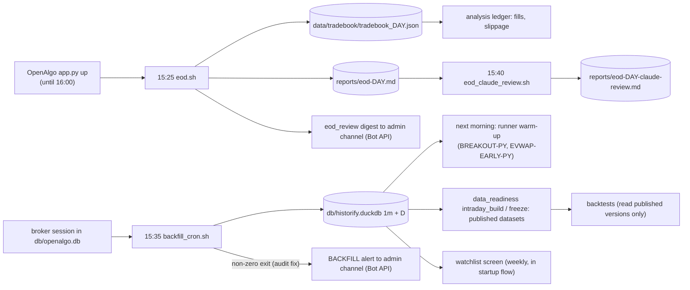
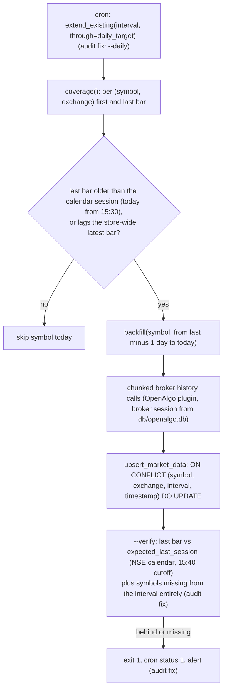

# Scheduled jobs and data pipeline

Status: verified 2026-10-22 from `crontab -l`, the Windows Task Scheduler (task definitions and the
TaskScheduler/Operational event log), the scripts themselves, their logs, and read-only queries of
`db/historify.duckdb`. "Audit fix" marks changes on branch `review/signal-engine-audit-2026-10-22`
(not deployed; scheduler definitions change only when re-registered).

## 1. Every scheduled job

| Job | Scheduler | When (IST) | What it runs | Evidence of last run |
| --- | --- | --- | --- | --- |
| `openAlgoAutoStart` | Windows task | 08:50 Mon-Fri, WakeToRun, StartWhenAvailable | `openalgoctl.ps1 dailystart` -> `openalgoctl.sh`: app.py, broker login (`openalgoscheduler startup`, which also runs the weekly watchlist screen), `signal_engine.main`, supervisor loop | Ran 2026-10-22 (late: PC woke 10:19) |
| `openAlgoWatchdog` | Windows task | every 5 min 09:00-16:00 | `openalgoctl.ps1 start` (no-op if healthy) | Missed every run on 10-19, 10-20, 10-22 (event 153); ran 10-15, 10-16, 10-21 |
| `openAlgoHeartbeatCheck` | Windows task | every 10 min 09:05-16:00 | `heartbeat_check.ps1`: desktop popup if `logs/heartbeat.txt` is older than 10 min (no Telegram dependency) | Same miss pattern as the watchdog |
| `openAlgoSquareOff` | Windows task | 14:55, WakeToRun | `openalgoctl.ps1 squareoff` -> `openalgoscheduler squareoff` (failsafe MIS close) | Ran 2026-10-22 14:55, result 0 |
| `openAlgoAutoStop` | Windows task | 16:00 | `openalgoctl.ps1 stop` | Ran 2026-10-22 16:00, result 0 |
| `breakingTradeAutoStart` / `Watchdog` / `AutoStop` | Windows tasks | 09:10 / every 5 min 09:15-15:15 / 15:35 | `breakingtradectl.ps1` -> `analysis/breakingtrade/poller.sh` -> `python -m signal_engine.analysis.breakingtrade --watch` | Ran 2026-10-22; `logs/breakingtrade_poller.log` current |
| `eod.sh` | user crontab | 15:25 Mon-Fri | tradebook snapshot (only source of fill prices), ledger, BreakingTrade review, errors, pages-vs-fills check, `eod_review` (Telegram digest) | `logs/eod_cron.log`: 2026-10-22 report written |
| `backfill_cron.sh` | user crontab | 15:35 Mon-Fri | `backtest.backfill` extend 1m and D, then `--verify` | `logs/backfill_cron.log`: 2026-10-22 |
| `eod_claude_review.sh` | user crontab | 15:40 Mon-Fri | `claude` CLI, report-only review following `.claude/skills/eod` | `logs/eod_claude_cron.log`: 2026-10-22, exit 0 |
| `weekly.sh` | none | header documents Saturday 09:00 cron, but no crontab entry exists | weekly review report | newest report `weekly-2026-09-24*.md`: effectively retired |
| `watchlist_screen.sh` | none (manual) | normal path is in-process, step 6 of `openalgoscheduler startup` | weekly watchlist refresh + Telegram digest | in-process path logs to `openalgoctl.log` |
| `scan.sh` | `breakingtradectl.ps1 audit` (manual) | on demand | BreakingTrade collection audit | n/a |

Not used: OpenAlgo's own Historify scheduler (`historify_schedules` table is empty, no executions)
and systemd timers (none for this project).

## 2. After-close timeline and dependencies

```mermaid
gantt
    title Weekday after-close jobs (IST)
    dateFormat HH:mm
    axisFormat %H:%M
    section Market
    Continuous trading        :09:15, 15:15
    Closing auction (F&O)     :15:15, 15:35
    section Engine
    MIS time exit             :milestone, 14:45, 0m
    Failsafe square-off task  :milestone, 14:55, 0m
    section Cron
    eod.sh                    :15:25, 3m
    backfill_cron.sh          :15:35, 5m
    eod_claude_review.sh      :15:40, 10m
    section Stack
    openAlgoAutoStop          :milestone, 16:00, 0m
```

Downstream consumers of `db/historify.duckdb`: the live runner warm-up
(`pipeline/context.HistorifyLoader`), the dataset builders (`backtest/data_readiness/intraday_*.py`), research
backtests via `backtest/data.from_historify`, and the watchlist screen. The GUI does not replace
any of them: the GUI's Strategy P&L and Performance pages read OpenAlgo's own strategy book.

## 3. Backfill behavior (`backtest/backfill.py`)

Properties confirmed:

- Idempotent: upsert keyed on (symbol, exchange, interval, timestamp); a re-fetch overwrites.
- Checkpointed: each chunk is upserted independently, so an interrupted run resumes.
- Interior gaps: `--repair-gaps` exists (manual), bounded by broker depth (`INTRADAY_DEPTH_DAYS` = 350).
- Calendar: `research/reference/nse_calendar.yaml` covers 2016-2026; verify and repair stop with
  exit 3 on 2027-01-01 until it is extended from the official NSE circular.
- **Rhythm.** Before the audit fix the cron used `min_stale=2` calendar days, so the bulk fetch ran
  every other trading day (log, 2026-09-29 to 10-22: 164 symbols on fetch days, 0 to 2 on skip
  days) and the runner lacked the previous session on the mornings in between ([gaps.md](gaps.md)
  G1). With `--daily` every symbol behind the calendar session is fetched each trading day, and
  verify checks the same session. `min_stale` remains the gate for manual runs without `--daily`.

## 4. Market and volume profile data

| Metric | Implementation | Source data | Persisted? |
| --- | --- | --- | --- |
| PVAH / PPOC / PVAL (live runner, BREAKOUT) | `features/value_area.py` (Pine port): volume spread evenly over each 1m bar's low-high rows, row = 5 x SymToken tick, 70%, continuous session only (before 15:15) | 1m bars | No, computed per run |
| POC / VAH / VAL (research adapters `value_area_fade`, `open_drive`) | `backtest/volume_profile.py` via the `MarketProfile` library: volume binned on each bar's close, about 30 rows per session | 1m bars | No |
| Initial Balance | `features/levels.initial_balance` (5m bars, first N minutes); `backtest/indicators.initial_balance_ratio` | 5m and 1m bars | No |
| TPO | Not implemented in code. BreakingTrade vendor snapshots carry vendor-computed fields (`breakingtrade.db` `snapshots`) | vendor Excel | Yes (vendor values) |

Granularity: 1m OHLCV approximates volume-at-price (no tick data); both implementations document
this. Daily bars alone cannot produce any of these profiles.

Session boundary: the closing auction (since 2026-08-03) prints about half the day's volume in one
bar stamped 15:28 or 15:29. Audit fix: `backtest/volume_profile.py` now also excludes bars from
15:15, matching `features/value_area.py` and the recorded decision; before, that print set the POC.

Coverage (read-only query, 2026-10-22): 1m 214 symbols; each full session 375 bars per symbol,
09:15-15:29. Daily: 210 symbols; **M&M and NIFTY have 1m history but no daily bars**; COCHINSHIP
and GVT&D are not served by the 1m endpoint (tolerated in cron). One stray post-close bar:
KALYANKJIL 2026-10-14 15:36.

## 5. Failure handling summary

| Failure | Detected by | Alert |
| --- | --- | --- |
| Broker session down at 15:35 | `backfill.py` raises, cron status 1 | audit fix: Bot API alert (before: log only) |
| Store behind or symbol never stored | `--verify` | audit fix: same alert; never-stored symbols now listed |
| eod.sh tradebook snapshot fails | `eod.sh` exit 2, report banner | eod_review digest still posts |
| Concurrent manual and cron run | `flock` on `logs/.eod.lock` and `.backfill.lock` | FATAL line; audit fix: no more daily false "abandoned lock" warning, hung-holder takeover kept |
| Calendar past 2026 | verify and repair exit 3 | log only |
