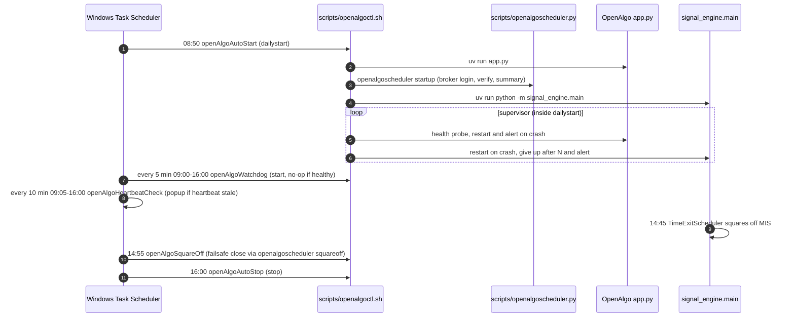
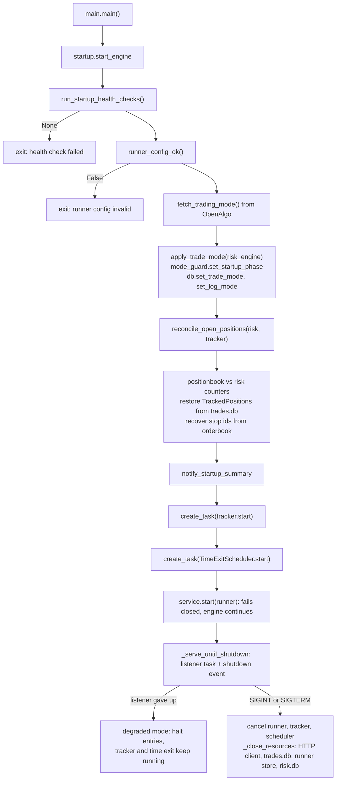
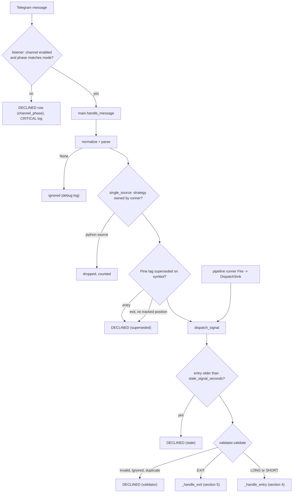
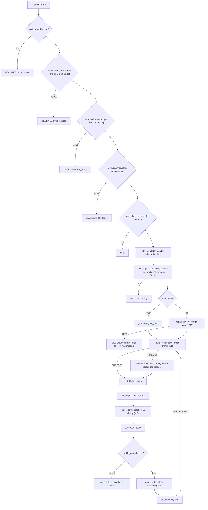
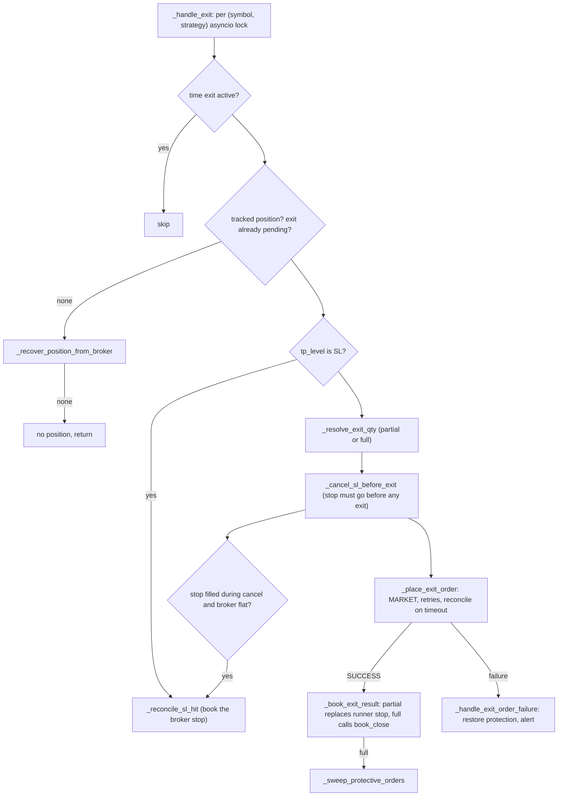
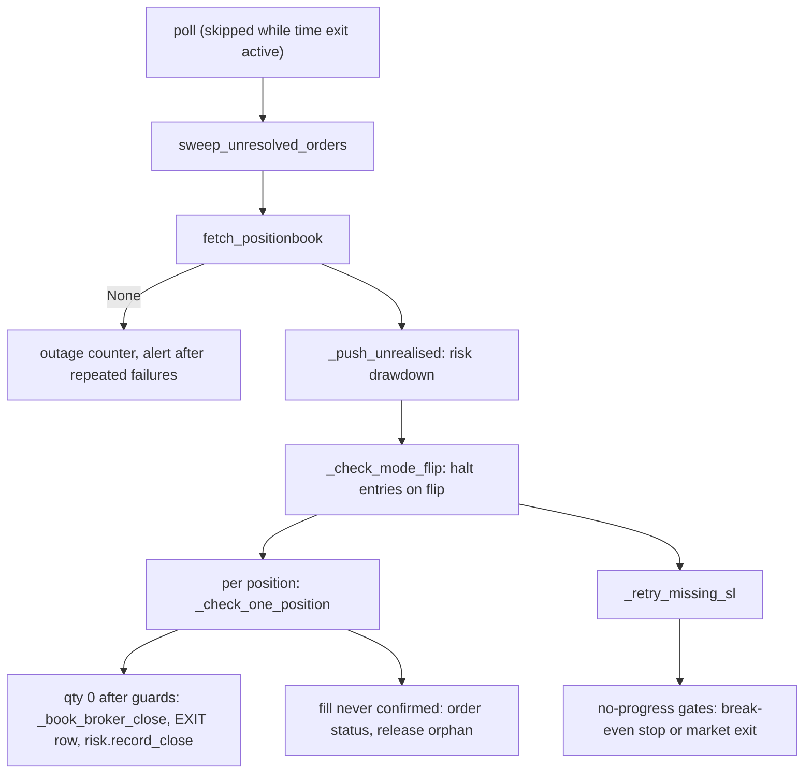
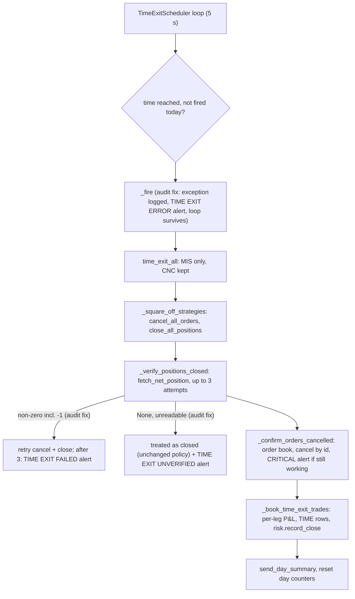
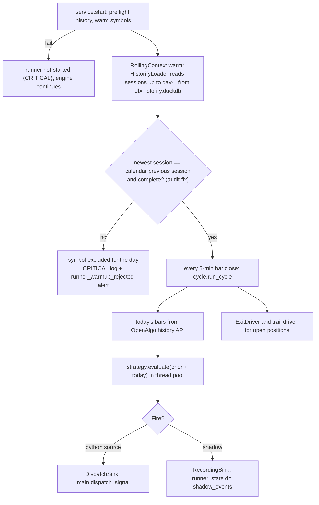
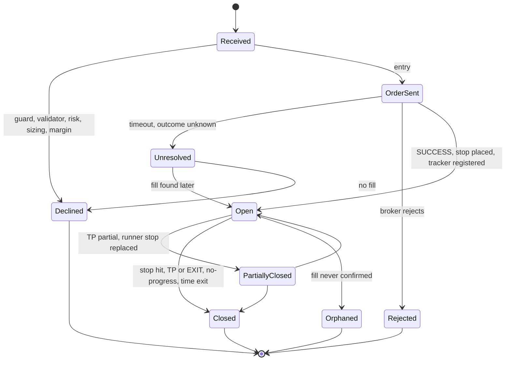

# signal_engine execution flow

Status: verified 2026-10-22 against the code on branch `review/signal-engine-audit-2026-10-22`.
"Audit fix" marks behavior changed on that branch (not deployed). See [architecture.md](architecture.md)
for components and [gaps.md](gaps.md) for open issues.

## 1. Daily process lifecycle (who starts what)

Note: the two repeating tasks miss the whole day when the PC wakes after their first trigger
(verified 2026-10-19, 10-20, 10-22); the script fix sets `StartWhenAvailable=true` (audit fix,
needs re-registration). See [data-pipeline.md](data-pipeline.md) for the cron jobs.

## 2. Engine startup (`startup._run_engine`)

Restart attribution (`_lookup_entry_legs` / `_lookup_entry_trade`) matches today's `trades.db`
entry rows to the broker's netted quantity and side. Audit fix: the side comparison now reads the
`Direction` enum correctly (`startup._direction_name`); before it, no row ever matched a side.

## 3. Signal intake to dispatch

## 4. Entry path (`main._handle_entry`)

Persistence note: the entry row is written last, after network calls; see [gaps.md](gaps.md) G7.

## 5. Exit path (`main._handle_exit` -> `_handle_exit_locked`)

## 6. Position tracking poll (`PositionTracker.check_positions`, every `tracking.poll_interval`)

## 7. Time exit (14:45 IST, `TimeExitScheduler` -> `time_exit_all`)

## 8. Python runner cycle (`pipeline/`)

Audit fix (G1): `HistorifyLoader.load` drops bars on non-session days, then rejects a symbol whose
newest session is not the NSE calendar's previous session, or whose previous session has fewer than
324 continuous 1m bars or none from 15:10 (special sessions exempt). If the calendar cannot answer,
every symbol is rejected. Before the fix, a store missing yesterday made the strategy read the
session before it (2026-10-14, PFC).

## 9. Signal and position state

## 10. Restart and recovery

| Situation | Behavior | Where |
| --- | --- | --- |
| Engine restart mid-session | Counters from `risk.db`; positions restored from broker book plus today's `trades.db` entries; stop ids from the order book; missing stops re-placed next poll | `startup.reconcile_open_positions`, `tracker._retry_missing_sl` |
| Telegram listener dies | Degraded mode: entries halted, management continues | `startup._enter_degraded_mode` |
| OpenAlgo mode flips | Entries halted for the session | `tracker._check_mode_flip`, `mode_guard` |
| Positionbook outage | Poll skipped, alert after repeated failures | `tracker._note_positionbook_failure` |
| Order timeout | Order book reconcile, then held as unresolved and swept each poll | `order_reconcile.py`, `main.sweep_unresolved_orders` |
